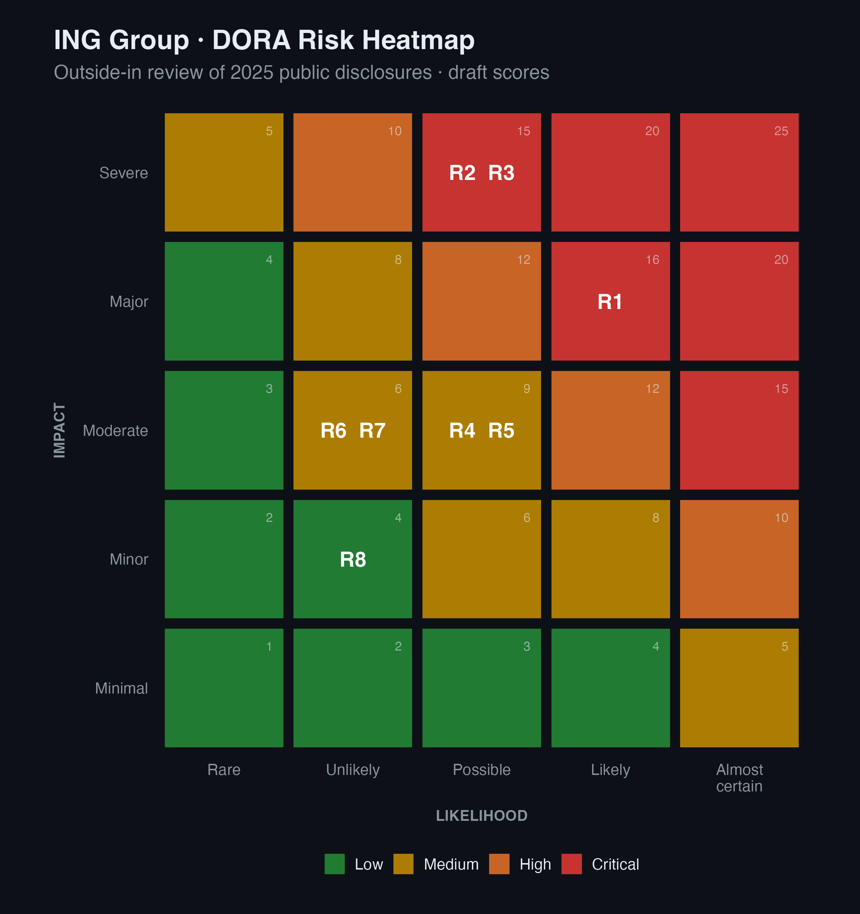

# ING Group – DORA Outside-In Readiness Review – 2026 Update to MSc Analysis

## Step 1 – Project Charter

| Item | Detail |
| --- | --- |
| Project title | ING Group: DORA Outside-In Readiness Review |
| Author | Aniketh Indiresh Ail |
| Objective | Assess how far ING Group's public disclosures show alignment with DORA, nearly two years after it began applying in January 2025. |
| Scope | ING Group 2025 Annual Report and related public reports, mapped to DORA's five pillars. |
| Out of scope | ING's internal controls, systems or non-public documents. No claims of non-compliance. |
| Method | Requirements checklist, evidence mapping, rating, risk register, recommendations. |
| Deliverables | Gap analysis table, risk heatmap, top-risk register, prioritised roadmap, portfolio case study page. |
| Reference material | This is a 2026 update to my original MSc analysis (MSc Cybersecurity Risk Management, NUI Galway), a DORA compliance risk analysis of ING Group. That work covered 2020–2024 annual reports, a gap analysis, risk scoring and a FAIR summary. This update redoes the analysis from scratch on 2025 data, using the original as reference. |
| Timeline | \[Set on completion\] |

## Project Steps

1. Project charter (this section)
2. Requirements checklist (below)
3. Evidence gathering from the 2025 Annual Report
4. Gap rating per requirement
5. Risk register and heatmap
6. Recommendations roadmap
7. Portfolio case study

Scope: An outside-in assessment of ING Group's public disclosures against the five pillars of DORA (Regulation (EU) 2022/2554). This judges public evidence only, not internal controls.

Rating scale: Clear evidence / Partial / Disclosure gap (not disclosed in public sources reviewed; does not imply non-compliance).

Sources to use: ING latest Annual Report, Pillar 3 / risk management disclosures, public statements on cyber, cloud and outsourcing.

## Pillar 1 – ICT Risk Management (Art. 5–16)

| Ref | Requirement | ING evidence | Source & page | Rating |
| --- | --- | --- | --- | --- |
| 1.1 | Management body holds ultimate responsibility for ICT risk (Art. 5) | MBB and EB informed of key IT/cyber risks quarterly; MBB told immediately of material cyber incidents; SB Risk Committee reviews dashboards on IT risk, cybersecurity and third-party risk every quarter; SB met 13 times in 2025 with operational resilience and cybersecurity as focus topics; CTO sits on MBB; risk appetite framework approved by SB. | AR 2025, p.41, p.43, p.210; 20-F 2025, p.136–137, p.155 | Clear evidence |
| 1.2 | Documented ICT risk management framework, reviewed regularly (Art. 6) | Information and Technology Risk Policy within the Non-Financial Risk Framework, with Minimum Standards; ERM framework reviewed regularly. | 20-F 2025, p.136, p.154 | Clear evidence |
| 1.3 | Digital operational resilience strategy (Art. 6) | "Staying safe and secure" is one of four strategic enablers; SB Technology & Operations Committee discussed ING's cybersecurity strategy with the Risk Committee in 2025; Operational Resilience framework is a multi-year journey. The strategy itself is not published. | AR 2025, p.14, p.45, p.211 | Partial |
| 1.4 | Up-to-date, resilient ICT systems and tools (Art. 7) | IT Resilience a key focus; enhancing failover and recovery of global, shared systems. | AR 2025, p.211 | Partial |
| 1.5 | Identification and classification of ICT assets and risks (Art. 8) | Cyber threat assessments and regular first-line scenario analysis; periodic risk identification. No ICT asset inventory disclosed. | 20-F 2025, p.136, p.155 | Partial |
| 1.6 | Protection and prevention measures (Art. 9) | Secure architecture, engineering and Identity & Access Management as preventive controls; cybersecurity maturity increased, notably IAM. | 20-F 2025, p.136; AR 2025, p.211 | Clear evidence |
| 1.7 | Detection of anomalous activity (Art. 10) | Security detection and response functionality to give timely alerts of malicious behaviour. | 20-F 2025, p.136 | Clear evidence |
| 1.8 | ICT business continuity policy and response plans (Art. 11) | Operational Resilience framework safeguards critical business services; SB Risk Committee reviews the annual update of ING's Recovery Plan; MBB self-evaluation notes improved focus on operational/IT resilience. | AR 2025, p.43, p.46, p.211 | Partial |
| 1.9 | Backup, restoration and recovery procedures (Art. 12) | Developing capabilities to recover from large-scale ransomware events; tested in 2025. ING itself warns that, despite business continuity plans, some systems may have insufficient recovery capabilities after a malfunction or data loss. | AR 2025, p.211; 20-F 2025, p.21 | Partial |
| 1.10 | Learning and evolving, incl. staff ICT security training (Art. 13) | Mandatory annual cybersecurity e-learning for internal and external staff (92% completion target); 2025 curriculum incl. Operational Resilience and Cybersecurity; board education on IT risk. | 20-F 2025, p.137, p.155 | Clear evidence |
| 1.11 | Crisis communication plans (Art. 14) | Internal escalation defined: MBB informed immediately of material cyber incidents; larger incidents discussed ad hoc with SB Risk Committee. External crisis communication plan not described. | 20-F 2025, p.137 | Partial |

## Pillar 2 – ICT Incident Management and Reporting (Art. 17–23)

| Ref | Requirement | ING evidence | Source & page | Rating |
| --- | --- | --- | --- | --- |
| 2.1 | ICT incident management process (Art. 17) | CISO office predicts, prevents, detects and responds to threats and incidents; material incidents escalated to MBB immediately. | 20-F 2025, p.136–137 | Partial |
| 2.2 | Classification of incidents and cyber threats (Art. 18) | Risks classified by impact and likelihood in the ERM risk cycle; "material" cyber incidents trigger escalation. DORA incident classification criteria not described. | 20-F 2025, p.137, p.155 | Partial |
| 2.3 | Reporting of major incidents to the regulator (Art. 19) | Two DDoS incidents reported to supervisors in 2025: one hit retail channels in Belgium, Italy and the Netherlands; one disrupted a third-party Polish mobile payment service. | 20-F 2025, p.136 | Clear evidence |
| 2.4 | Informing affected clients of major incidents (Art. 19) | Not disclosed for 2025. ING states the incidents were "swiftly contained, minimising the impact to our customers" but does not describe client notification. Past DDoS attacks on ING were publicly acknowledged by the bank in media reports (2018), so a disclosure practice exists historically. | 20-F 2025, p.136; Yahoo News / SecurityWeek (2018) | Disclosure gap |
| 2.5 | Voluntary notification of significant cyber threats (Art. 19) | Works with government (e.g. National Cyber Security Centre), law enforcement and peers on cybercrime resilience; voluntary threat notifications to authorities not specifically described. | 20-F 2025, p.136 | Partial |

## Pillar 3 – Digital Operational Resilience Testing (Art. 24–27)

| Ref | Requirement | ING evidence | Source & page | Rating |
| --- | --- | --- | --- | --- |
| 3.1 | Risk-based resilience testing programme (Art. 24) | Outage simulations for critical business services and ransomware recovery testing. The ECB's 2024 cyber resilience stress test identified areas for improvement in ING's response and recovery capabilities (reflected in the 2024 SREP), leading to enhanced cyber resilience measures. | 20-F 2025, p.21, p.136; AR 2025, p.211 | Partial |
| 3.2 | Testing of ICT tools and systems, e.g. vulnerability scans, scenario tests (Art. 25) | More real-life outage simulations under severe stress scenarios, incl. contingency measures. | AR 2025, p.211 | Partial |
| 3.3 | Threat-led penetration testing (TLPT) at least every 3 years (Art. 26) | ING does not disclose TLPT. Context: DORA TLPT applies since 17 January 2025, and the ECB updated TIBER-EU in February 2025 to align with DORA TLPT. ING's "real-life simulations of outages" are resilience tests, not threat-led red teaming. | AR 2025 p.211; 20-F Item 16K; ECB TIBER-EU Guide (Nov 2025); ECB news (Feb 2025) | Disclosure gap |
| 3.4 | Requirements for testers (Art. 27) | Global CISO, key security roles and Group IT Audit fully internally staffed; external auditor audits key controls for financial reporting. External red-team tester requirements not described. | 20-F 2025, p.136 | Partial |

## Pillar 4 – ICT Third-Party Risk (Art. 28–44)

| Ref | Requirement | ING evidence | Source & page | Rating |
| --- | --- | --- | --- | --- |
| 4.1 | Third-party risk strategy and policy (Art. 28) | Third-Party Cyber Risk Management process within the NFR framework; investment in third-party risk controls "aligned with DORA requirements"; SB Risk Committee discussed management of third-party risk in relation to outsourcing; oversight of material subcontractors being strengthened. | 20-F 2025, p.136; AR 2025, p.43, p.211 | Clear evidence |
| 4.2 | Register of information on all ICT third-party arrangements (Art. 28) | No mention of a DORA register of information on ICT third-party arrangements. | AR 2025 p.210–214; 20-F Item 16K | Disclosure gap |
| 4.3 | Pre-contract due diligence (Art. 28) | Third-party due diligence covers bribery and corruption risk; supplier cyber risk monitored via Third-Party Cyber Risk Management. ICT-specific pre-contract assessment not described. | AR 2025, p.213; 20-F 2025, p.136 | Partial |
| 4.4 | Exit strategies for critical providers (Art. 28) | ING notes regulators emphasise contingency planning for critical service providers, but does not describe its own exit strategies. | 20-F 2025, p.151 | Disclosure gap |
| 4.5 | Assessment of ICT concentration risk, e.g. cloud (Art. 29) | Measures on concentration risk in place; supplier concentration risk management to be further enhanced. | AR 2025, p.211 | Partial |
| 4.6 | Key contractual provisions (Art. 30) | Policy requires third parties to give GDPR-equivalent data protection, especially for transfers outside the EEA. DORA Art. 30 contract terms not described. | AR 2025, p.214 | Partial |
| 4.7 | Awareness of oversight of critical ICT providers (Art. 31–44) | ING acknowledges DORA reshaped third-party oversight expectations and flags reliance on cloud and third-party vendors as a systemic challenge. | 20-F 2025, p.151 | Partial |

## Pillar 5 – Information Sharing (Art. 45)

| Ref | Requirement | ING evidence | Source & page | Rating |
| --- | --- | --- | --- | --- |
| 5.1 | Participation in cyber threat intelligence sharing arrangements (Art. 45) | Collaborates on cybercrime resilience with financial peers, law enforcement, government (e.g. National Cyber Security Centre) and ISPs; financial-crime PPPs. | 20-F 2025, p.136; AR 2025, p.213 | Clear evidence |
| 5.2 | Notification to authorities of participation (Art. 45) | Participation in sharing arrangements is disclosed, but notification of that participation to competent authorities is not described. | 20-F 2025, p.136 | Disclosure gap |

## Supplementary evidence – Pillar III Report 2025

Operational risk RWA rose 17.6% to €45.3bn in 2025, mainly because CRR III moved the calculation to the Business Indicator Component. Net operational losses halved to €184m, but the number of loss events rose 23%.

| Metric (operational risk) | 2025 | 2024 | Source & page |
| --- | --- | --- | --- |
| Risk-weighted assets (€m) | 45,288 | 38,500 | Pillar III 2025, p.6–7 (EU OV1) |
| Minimum capital requirement (€m) | 3,623 | 3,080 | Pillar III 2025, p.7 (EU OV1) |
| Economic capital (€m) | 3,104 | 3,080 | Pillar III 2025, p.5 |
| Net losses, events ≥ €20k (€m) | 184 | 357 | Pillar III 2025, p.136 (EU OR1); 10-year average 359 |
| Loss events ≥ €20k (count) | 1,073 | 874 | Pillar III 2025, p.136 (EU OR1); 10-year average 749 |
| Net losses, events ≥ €100k (€m) | 162 | 338 | Pillar III 2025, p.136 (EU OR1); 10-year average 344 |

What it adds for DORA: the Non-Financial Risk framework uses three lines of defence, records loss events, issues, risks and controls in one system (iRisk), reports through an NFR Dashboard to senior management and the Board, and lists business continuity planning and cyber insurance as mitigations (p.135). This supports rows 1.2 and 1.8 but does not mention DORA, ICT incidents or ICT third parties.

Disclosure gap: losses are not split by event type, so the cost of ICT and cyber incidents cannot be seen. DORA Art. 11(10) requires an estimate of annual costs and losses from major ICT incidents to be available to authorities on request.

Source: [ING Group Additional Pillar III Report 2025](https://ing.com/binaries/content/assets/documents/annual-reports/2025-ing-groep-nv-additional-pillar-iii-report.pdf)

## Step 5 – Risk Register (draft)

The top risks are DDoS on customer channels and failure of a critical ICT third party, both seen in real incidents in 2025. Scores are draft analyst judgements on a 1–5 scale (Score = Likelihood × Impact), to be reviewed.

| ID | Risk | Linked rows | Evidence | Likelihood (1–5) | Impact (1–5) | Score |
| --- | --- | --- | --- | --- | --- | --- |
| R1 | DDoS attack disrupts retail customer channels | 1.7, 2.3 | Two DDoS incidents reported to supervisors in 2025 | 4 | 4 | 16 |
| R2 | Outage or failure of a critical ICT third party, worsened by concentration | 4.4, 4.5, 4.7 | 2025 DDoS hit a third-party Polish payment service; exit strategies not disclosed | 3 | 5 | 15 |
| R3 | Ransomware event with slow or incomplete recovery | 1.8, 1.9, 3.1 | ECB 2024 cyber stress test found areas to improve; ING warns some systems may lack recovery capability | 3 | 5 | 15 |
| R4 | Supervisory finding over TLPT not evidenced | 3.3, 3.4 | No TLPT disclosed; DORA TLPT applies since Jan 2025 | 3 | 3 | 9 |
| R5 | Incident misclassified or reported late under DORA criteria | 2.2, 2.3 | DORA classification criteria not described | 3 | 3 | 9 |
| R6 | Incomplete register of information on ICT third parties | 4.2, 4.6 | No mention of the register or Art. 30 contract terms | 2 | 3 | 6 |
| R7 | Affected clients not informed of a major incident | 2.4, 1.11 | Client notification and external crisis communication not described | 2 | 3 | 6 |
| R8 | Cost of ICT incidents not visible or quantified | Pillar III | Losses not split by event type (Art. 11(10)) | 2 | 2 | 4 |

Heatmap: built in R (ggplot2), saved as ing\_dora\_heatmap.png. R1, R2 and R3 fall in the Critical band; R4–R7 Medium; R8 Low.

## Step 6 – Recommendations Roadmap (draft)

Priority goes to the three Critical risks: DDoS resilience, critical third-party exit planning and ransomware recovery. Recommendations are outside-in suggestions based on public disclosures, not findings about ING's internal controls.

| Priority | Recommendation | Addresses | Linked rows | Horizon |
| --- | --- | --- | --- | --- |
| 1 | Strengthen DDoS protection for customer channels and test failover to backup channels | R1 | 1.7, 2.3 | 0–6 months |
| 2 | Document and test exit strategies for critical ICT providers; disclose the approach at a high level | R2 | 4.4, 4.5 | 0–6 months |
| 3 | Close recovery gaps found in the ECB 2024 cyber stress test; run full ransomware recovery exercises | R3 | 1.8, 1.9, 3.1 | 0–12 months |
| 4 | Disclose the TLPT cycle (TIBER-EU aligned) and that testers meet DORA Art. 27 | R4 | 3.3, 3.4 | 6–12 months |
| 5 | Map internal incident taxonomy to DORA classification criteria and reporting deadlines | R5 | 2.2, 2.3 | 6–12 months |
| 6 | Confirm the register of information is complete and contracts carry Art. 30 terms | R6 | 4.2, 4.6 | 6–12 months |
| 7 | Publish a client communication approach for major ICT incidents | R7 | 2.4, 1.11 | 12–18 months |
| 8 | Tag operational losses by event type so ICT and cyber incident costs are visible | R8 | Pillar III | 12–18 months |

## Step 7 – Portfolio Case Study (draft copy)

Draft text for a case study page on the portfolio site; to be built with Claude Code.

**Title:** ING Group – DORA Readiness Review (2026 update to my MSc analysis)

**Summary:** An outside-in review of how far ING Group's 2025 public disclosures show alignment with the EU Digital Operational Resilience Act (DORA). It updates the DORA compliance risk analysis I did for my MSc in Cybersecurity Risk Management at NUI Galway, redone from scratch on 2025 data.

**What I did**

1. Built a requirements checklist of 29 DORA requirements across the five pillars.
2. Mapped evidence from ING's 2025 Annual Report, 20-F and Pillar III Report, with page references.
3. Rated each requirement as Clear evidence, Partial or Disclosure gap.
4. Built a risk register of eight risks, scored on likelihood and impact.
5. Plotted a risk heatmap in R (ggplot2).
6. Wrote a prioritised recommendations roadmap.

**Key findings**

- ING names DORA directly and links its cyber and third-party controls to it.
- Two DDoS incidents reported to supervisors in 2025, one through a third-party payment service, match risks flagged in my original MSc analysis.
- The main disclosure gaps are threat-led penetration testing, the register of information, exit strategies for critical ICT providers and client notification of incidents.
- Three risks scored Critical: DDoS on customer channels, critical third-party failure and ransomware recovery.

**Tools:** Public filings analysis, DORA (Regulation (EU) 2022/2554), R and ggplot2.

**Disclaimer:** Based only on public disclosures. Disclosure gaps mean information was not found in the sources reviewed; they do not imply non-compliance. Not affiliated with or endorsed by ING.

## Notes

ING explicitly names DORA: it says DORA reshaped expectations for ICT risk management, incident reporting and third-party oversight (20-F p.151), and that cyber and third-party controls are aligned with DORA (20-F p.136). The two 2025 DDoS incidents, one via a third party, are real-world evidence for the DDoS and vendor risks in the original MSc analysis.
